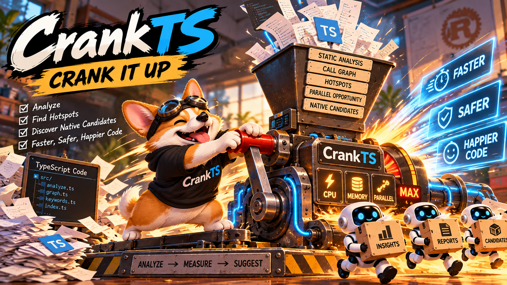
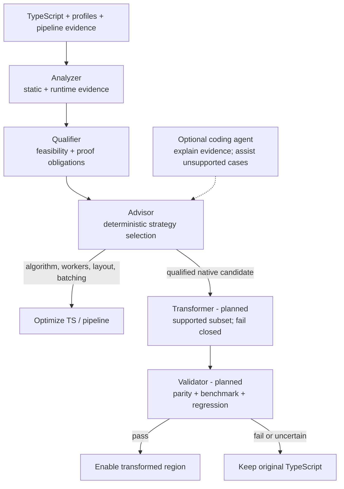

# CrankTS

<p align="center">
  
</p>

<p align="center"><strong>Crank up your TS.</strong></p>

> [!IMPORTANT]
> **CrankTS v0.1 is an experimental analyzer preview.** It produces evidence and recommendations, but does not rewrite source code or generate native implementations. Report formats and heuristics may change before v1.0.

<p align="center">
  
</p>

> **Write TypeScript. Pay for dynamism only where you use it.**

CrankTS is an evidence-first, deterministic acceleration system for existing TypeScript projects. It finds acceleration opportunities, qualifies safe transformations, and is designed to automatically offload supported regions without requiring a manual rewrite.

**Today:** static analysis, profile correlation, and deterministic advice. **Next:** a fail-closed transformer with parity and performance validation. The current CLI does not execute the analyzed application, rewrite its source, or generate native code.

Native offload is a core execution strategy when evidence supports it. The advisor determines whether native execution, an algorithm change, workers, a compact data layout, or batching is justified before a transformation is attempted.

## Quick Start

Requires Node.js 22+ and pnpm.

```bash
pnpm install
pnpm dev analyze src/

# Build and run the CLI
pnpm build
node dist/cli.js analyze /path/to/project
```

The target can be a file or directory and defaults to the current directory. CrankTS loads the nearest `tsconfig.json`, uses the project's installed TypeScript compiler when available, and includes transitively resolved local callees in the analysis.

```bash
# Detailed call and parallelism evidence
pnpm dev analyze src/ --verbose

# Versioned machine-readable report
pnpm dev analyze src/ --format json

# Filter candidate islands by static Native Priority
pnpm dev analyze src/ --min-score 70

# Attach existing workload measurements and a pipeline descriptor
pnpm dev analyze src/ --profile ingest.cpuprofile
pnpm dev analyze src/ --heap-profile allocations.heapprofile --workload "request replay"
pnpm dev analyze ../intentweave/packages/analyzer --pipeline evaluation/intentweave-pipeline.json

# Include transitive TypeScript project references (opt-in)
pnpm dev analyze . --workspace-references

# Write per-stage wall time and memory of the analysis itself to a separate file
pnpm dev analyze . --timings timings.json

# Lower an explicitly selected kernel to a Rust/N-API crate (fails closed unless its contract is lowerable)
pnpm dev extract test/fixtures/lowering/src/graph-kernel.ts#graphBatch \
  --shape GRAPH_BATCH --graph offsets,neighbors --out /tmp/graph-kernel
```

Project-reference analysis creates a separate TypeScript program and checker per referenced project, then joins source-resolved calls using stable workspace-relative IDs. The default remains single-project analysis. Imports whose implementation is available only through declaration files remain external boundaries.

## How It Works

The target architecture separates evidence, qualification, strategy selection, transformation, and validation:



Advisor-to-transformer is a mechanical transition gated by proof obligations, not an agent hop. An optional coding agent can explain findings and propose experiments; it cannot raise confidence or authorize a transformation.

### Deterministic Transformation

Transformations must preserve observable behavior and fail closed. Every required language construct, type, effect, call boundary, and data representation must be supported by the selected backend. Unsupported or ambiguous code stays in TypeScript unchanged.

Generated code must pass differential parity checks and workload benchmarks before offload can be enabled, with the original TypeScript retained as a fallback. Agent-generated changes are outside this guarantee unless independently qualified and validated.

## What the Current Analyzer Reports

| Question | Evidence |
| --- | --- |
| Can a region cross a runtime boundary? | Types, blockers, propagated effects, `SUPPORTED` / `CONDITIONAL` / `BLOCKED` eligibility |
| Where might acceleration help? | Independent CPU, memory, and parallel opportunity heuristics; connected candidate islands |
| Is it hot in this workload? | Optional CPU and allocation profiles, matched coverage, and confidence |
| Is work independent, and what limits scaling? | Conservative loop/batch analysis and declared pipeline/sink constraints |
| Which action is justified? | Evidence-linked recommendations for algorithms, workers, layout, offload, event-loop isolation, batching, or serialized sinks |

`Native Priority` combines static suitability and opportunity; it is **not a runtime ranking or a safety proof**. With a CPU profile, candidate presentation uses observed self CPU first. Boundary costs and component-quality metrics are experimental diagnostics, not measured transition costs.

Parallelism is a heuristic, not proof of independence; `Promise.all` does not establish CPU parallelism. Pipeline declarations are analyst-supplied evidence, not observed contention. Allocation samples do not measure retained heap or RSS. Low profile coverage keeps recommendations provisional.

See [analysis details and evaluation history](docs/analysis-and-evaluation.md) for scoring, report semantics, profile limitations, and the pipeline descriptor contract.

## IntentWeave Validation

IntentWeave is the first real-world validation target. Two experiments show why strategy selection matters:

- **Optimize the algorithm first:** profiling exposed KWX dictionary matching as a hotspot that static ranking missed. A TypeScript matcher rewrite reduced a single full-depth build from about 35 s to roughly 19 s; low post-change profile coverage makes this directional evidence, not a calibrated speedup claim.
- **Test parallel scaling:** an explicit IntentWeave worker experiment measured 19.4 s with one worker and 14.1 s with four; eight did not improve end-to-end time. Selected tables matched exactly, but full-database parity was not established. This was one run per configuration, not an automatic CrankTS transformation.
- **Measure the sink:** one instrumented 30-document build measured a 797 ms SQLite writer stage in an approximately 15 s run (~5%). Annotations took 366 ms, with 1,140 transactions and 386 ms in COMMIT calls. This does not isolate lock-wait or show that SQLite is the current bottleneck; the run had no producer queue and was not repeated.
- **Validate a native candidate:** a manual napi-rs scanner replaced only the ASCII dictionary scan during five full-depth builds. All 49,002 `KeywordMatch` objects matched across 11,010 document/comment chunks; median full build was 15.07 s TypeScript vs. 12.30 s with the preload (1.225x). The full extractor microbenchmark was 2.49x faster, but cold per-chunk dictionary transfer was slower. This remains a manual PoC with no RSS/GC data or production integration; `def_use_chains` also varies between TypeScript-only runs. Details: [MVP-8 native candidate evidence](evaluation/intentweave-mvp8-native-poc.json).

Run a separate measurement-only TS build with:

```bash
iw index build --depth full --sink-metrics /tmp/iw-sink-metrics.json --output /tmp/iw-index.db
```

The metrics option bypasses the native backend and writes a JSON report outside the index database. Full details and caveats are in [the evaluation history](docs/analysis-and-evaluation.md#mvp-7b-sqlite-sink-measurement).

CrankTS is also its own negative control. Profiling it on the full IntentWeave workspace showed 95% of wall time in TypeScript-compiler-bound stages and 0.7% in its graph passes, and its self-assessment kept every graph kernel `KEEP_TS`. A separate native WCC/Tarjan kernel matched exactly and was 2.9x faster on the real graph including transfer (4.2x at 100× scale), but that saves about 3 ms of 5.9 s. The `GRAPH_BATCH` shape works; offloading it inside CrankTS would not matter. Details: [MVP-9a](evaluation/crankts-mvp9a-self-profile.json), [MVP-9b](evaluation/crankts-mvp9b-graph-crossover.json).

These experiments support an evidence-led workflow, not blind TypeScript-to-Rust translation. When native offload is justified, CrankTS is intended to perform the qualified transformation itself.

Detailed measurements, caveats, and follow-up gates are in [the evaluation history](docs/analysis-and-evaluation.md#intentweave-evaluation-history).

## Roadmap

| Milestone | Deliverable |
| --- | --- |
| Analysis and validation | Measure native KWX RSS/GC and preserve mutable-dictionary semantics before integration; extend workspace-reference coverage for package methods/constructors; keep worker and sink claims tied to repeated parity-tested runs. |
| **v0.2: Deterministic Extraction** | Done: kernel contracts, boundary representations, reference contracts, and a Kernel IR with fail-closed lowering, proof-obligation discharge, and an interpreter that matches TypeScript on both PoC kernels, plus `crankts extract`, which generates a Rust/N-API crate, a TypeScript wrapper that falls back to the original function, and a differential parity runner ([lowering](docs/lowering.md)). Next: explicitly select and qualify a region in a small supported subset; emit a complete native implementation, stable TS-facing wrapper, and native boundary for one backend; retain TS fallback and generate parity tests and a repeatable benchmark harness. |
| **v0.3: Automatic Offload** | Introduce a stable Native IR and Rust/N-API backend; gate automatic region selection on proof, workload evidence, and boundary costs; integrate builds and reversible call-path replacement with validation and rollback. |

This is not arbitrary TypeScript-to-Rust translation. Other backends, including WebAssembly and native JIT, remain longer-term options.

## Development

```bash
pnpm test
pnpm typecheck
pnpm build
```

Technical context: [analysis and evaluation](docs/analysis-and-evaluation.md). Brand assets: [logo guide](ressources/crankts-logo-guide.md). License: [Apache-2.0](LICENSE).
