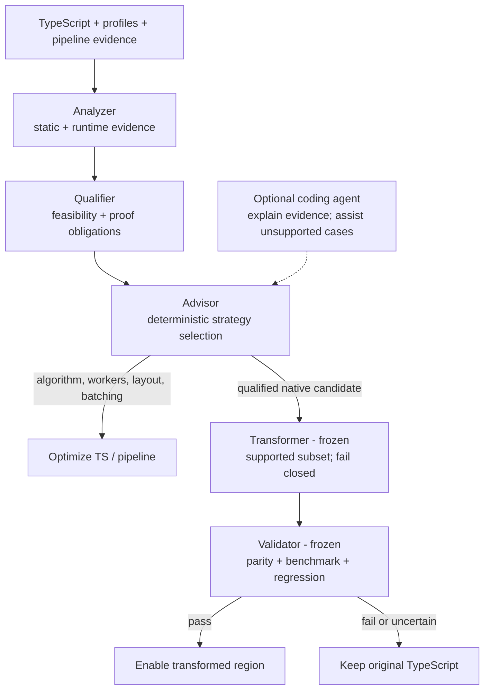

# CrankTS

<p align="center">
  
</p>

<p align="center"><strong>Crank up your TS.</strong></p>

> [!IMPORTANT]
> **CrankTS is a closed research experiment (2026-10-15), not a product, and it is no longer developed.** It started as a TypeScript-to-native offload idea and became an evidence-and-diagnosis tool. Six external evaluations and several gain measurements stopped the native direction. The last open bet was whether CrankTS's runtime evidence makes a coding agent pick better optimizations. It was tested by measured speedup and did not hold: an agent with a raw CPU profile did as well. The write-up is [docs/outcome.md](docs/outcome.md); see also [Status of the Experiment](#status-of-the-experiment). The code stays available as research code.

<p align="center">
  
</p>

> **Write TypeScript. Pay for dynamism only where you use it.**

CrankTS is an evidence-first performance analysis tool for existing TypeScript projects. It attributes profiled runtime to call sites (own code, dependencies, native addons, I/O), follows the dominant caller paths, probes expensive calls for repeated or duplicated work, and states what it measured separately from what it merely suspects.

**Today:**
- Static analysis, profile correlation, call-site attribution, and caller paths (`analyze`).
- A workload evidence probe that records call counts, repeated inputs, identical objects, and duplicate content, and derives observations and hypotheses with preconditions (v0.2.6e).
- `crankts observe [--entry <script>] -- <cmd...>` (Observe M1–M4), with the queries `summary`, `top`, `inspect`, `callers`, `callees`, `deps`, `sessions`, and `gc`, and `crankts mcp`, which serves them to coding agents: runs a workload three times, with the CPU profiler, precise coverage, and heap sampling that includes collected objects. It finds the primary Node process and writes a session to `.crankts/sessions/<id>/`, with CPU time, exact execution counts, hot block ranges, allocated bytes, and per-call estimates per entity. `crankts observe-m0 <file.cpuprofile> --root <dir>` (Observe M0) does the attribution for an existing profile: it attributes a V8 CPU profile to stable TypeScript code entities, covering self, inclusive, and caused time and observed caller edges. It writes compact JSON for agents ([plan](docs/observe-plan.md)).
- `crankts extract`, which transforms explicitly selected kernels into Rust/N-API crates. It does this only when a fail-closed contract validates, and each crate comes with a TypeScript fallback wrapper, a parity runner, and a benchmark with an acceptance gate. This backend is frozen (see below).

The `analyze` command does not execute the analyzed application or rewrite its source. Whether an optimization is worth making is decided by measuring a patch, not by this tool.

## Status of the Experiment

*As of 2026-10-15: **closed.** The write-up is [docs/outcome.md](docs/outcome.md). The decision records are in [docs/plan.md](docs/plan.md#decision-after-the-sixth-review-round-2026-10-11), [the Observe decision](docs/plan.md#decision-after-the-seventh-review-round-2026-10-13-observe), and [the final decision](docs/plan.md#final-decision-2026-10-15-project-closed); the data is in [docs/eval-generalization.md](docs/eval-generalization.md).*

### What the evidence says

Six projects were profiled and reviewed (Knip, TypeDoc, ESLint, Effect, noble-hashes as a compute-bound control, and one closed-source monorepo, whose details stay private):

- **The time is rarely in code a native backend can take.** On application code, the project's own JavaScript is 8–37% of runtime; the rest is dependencies, native code, I/O, and the runtime. No hot function in any application workload passed the lowering.
- **Native gain is small where it is possible.** A hand-written Rust SHA-256 kernel is 1.75× faster than V8. Native builds of ordinary TypeScript by scriptc 0.2.8 ran at 0.09–0.17× of V8. A plain algorithmic fix in TypeScript gave 1.8× on IntentWeave's hottest function, as much as the best native kernel. KWX native, measured earlier, was at parity with V8.
- **Parallelism does not need a native pool.** Where parallel work exists, `worker_threads` already reach it. On the closed-source project, scaling over several ingesters against Postgres stops at two (1.3×), because the database does 2–3× the application's CPU per entity.
- **The evidence layer reproduces known findings.** From runtime data alone, it found the two largest wastes in the closed-source project (identical objects hashed again, 16%, validated at −17% wall time; every entity indexed twice, 15%, validated up to −23%) and Knip's repeated `glob` option work (9%). It also produced a hypothesis that measurement refuted (a JSON-parse cache: −0.8%, within noise). Estimates and upper bounds are not gains; only a measured patch is.
- **The pattern-recognition approach did not generalize.** Per-hotspot recognizers reached single-digit percent coverage, and every project needed bespoke fixes.

### What is stopped, frozen, or parked

| Track | Status |
| --- | --- |
| General TypeScript-to-native lowering, a static or dynamic-native tier | **Stopped** |
| Native thread pool | **Stopped** (pipeline-level parallelism stays a topic for the advisor) |
| Kernel IR, Rust backend, proof obligations, parity gates | **Frozen**, kept as an opportunistic backend (native work only at an expected whole-workload gain of at least 10%) |
| `TransformationPlan` (v0.2.7) | **Parked** |
| Guarded specialization | **On hold** until a TypeScript-only specialization of a hot spot leaves a real gap |

### The last track: CrankTS Observe (closed 2026-10-15)

The seventh review round (2026-10-13) moved CrankTS from pattern recognition and advice to **code-level runtime observability for coding agents**. CrankTS runs a real workload, attributes CPU, executions, and allocations to stable TypeScript code entities with observed caller edges, and serves the result over CLI, JSON, and MCP. It reports measurements and does not interpret them. Plan: [docs/observe-plan.md](docs/observe-plan.md); decision record: [docs/plan.md](docs/plan.md#decision-after-the-seventh-review-round-2026-10-13-observe).

- **M0 done** (2026-10-13): the entity model and CPU path. On IntentWeave, 100% of own samples map to entities ([evaluation/observe-m0-intentweave.json](evaluation/observe-m0-intentweave.json)). **M1–M5 built**: `crankts observe -- <cmd>` writes a session with CPU attribution, exact execution counts, allocations, and per-call estimates ([M2](evaluation/observe-m2-intentweave.json), [M3](evaluation/observe-m3-intentweave.json)). The CLI queries and `crankts mcp` serve it to agents ([M4](evaluation/observe-m4-intentweave.json)). **Agent comparison (2026-10-14):** fresh agents scored 10/10 with Observe, 9/10 with the raw profile, and 8/10 with the `analyze` JSON on IntentWeave. All found the same #1 hotspot and fix; only the Observe agents quantified it with calls, iterations, and allocation. The 10 vs 9 over the raw profile comes from a rubric point only Observe could earn, so the v0.4 gate is not decided ([details](docs/observe-agent-comparison.md)). M5 (quality checks, schemas, toolchain matrix, overhead, CI) is done ([M5](evaluation/observe-m5-intentweave.json)).
- **Agent comparison 2 (2026-10-15), scored by measured speedup:** 12 valid runs on TypeORM and pdf-lib with three arms: P (raw CPU profile), P+ (raw CPU, coverage, and heap recordings without CrankTS), and O (Observe). No arm was better. Every run chose the same lever per workload, and O did not beat P+ (TypeORM 1.235 / 1.231 / 1.220, pdf-lib 1.154 / 1.190 / 1.151). The v0.4 gate is not met, and the project is closed ([results](docs/observe-agent-comparison.md#comparison-2-results-2026-10-15)).
- **Gates:** after M0, the output must be clearly easier for an agent to use than today's `analyze --profile` JSON. After M4, an agent must find hotspots and caller paths through MCP alone. If the M0 gate fails, CrankTS ends as a research write-up.
- **Agent ablation:** not run; superseded by the two comparisons. The prepared material stays in [evaluation/ablation](evaluation/ablation); the protocol is [docs/ablation-protocol.md](docs/ablation-protocol.md).

Native offload is no longer a promised direction. The earlier statement that CrankTS is intended to perform qualified transformations itself is withdrawn.

## Quick Start

Requires Node.js 22+ and pnpm.

```bash
pnpm install
pnpm dev analyze src/

# Build and run the CLI
pnpm build
node dist/cli.js analyze /path/to/project
```

### Observe a workload and query it (agents: MCP)

```bash
# In the project to observe: three runs (CPU, coverage, heap) → .crankts/sessions/<id>/
node /path/to/crankts/dist/cli.js observe -- node dist/main.js
# Several Node processes (npm, scripts)? Name the one that matters:
node /path/to/crankts/dist/cli.js observe --entry dist/main.js -- npm run start

# Query the newest session (--json gives the MCP structures)
crankts summary
crankts top --by self            # or inclusive | alloc | executions | cpu-per-call
crankts inspect GraphParser.parseNode   # key, unique name, or file:line
crankts callers parseNode
crankts deps

# Serve the sessions to a coding agent over MCP (stdio), e.g. for Claude Code:
claude mcp add crankts -- node /path/to/crankts/dist/cli.js mcp --root /path/to/project
```

Add `.crankts/` to the project's `.gitignore`. Keys look like `<package>::<module>::<name>`, e.g. `app::src/index.ts::buildIndex/items.map#cb0`. `crankts schema` prints the JSON Schemas of the session files. `--verify-determinism` repeats the coverage run and compares counts; `--baseline` adds an uninstrumented run and reports each measurement's overhead (IntentWeave: CPU 1.05×, coverage 1.38×, heap 1.07×).

**Limits of Observe.**
- **Separate runs:** CPU, coverage, and heap come from separate runs of the workload. Per-call values combine runs and are estimates with a confidence. Non-deterministic workloads show up in `--verify-determinism` and in the quality checks.
- **One process:** only the primary Node process is attributed. Child processes and workers are recorded, not merged; Rust/N-API code inside an addon is time in that dependency.
- **async:** CPU stacks end at `await`. Such entities carry `asyncTruncated`, and time spent waiting is not attributed.
- **Inlining:** an inlined leaf function's samples are moved back to it from the caller's per-line ticks (flag `inlinedSuspected`). An inlined *intermediate* function can disappear from stacks, so its callers' edges then skip it.
- **Wall-time weights:** CPU sample weights are wall time, as in Chrome DevTools, so heavy CPU contention during a run shifts shares.
- **Bundles:** top-level code is one entity per bundle (`<bundle>::(module)`), and dependencies inlined by a bundler are attributed through the source map to their package.
- **Requirements:** Node 22.18 or later for type-stripped `.ts` entry points; tsx and ts-node need the coverage measurement to map positions.

### Static analysis

The target can be a file or directory and defaults to the current directory. CrankTS loads the nearest `tsconfig.json`, uses the project's installed TypeScript compiler when available, and includes transitively resolved local callees in the analysis.

```bash
# Detailed call and parallelism evidence
pnpm dev analyze src/ --verbose

# Versioned machine-readable report
pnpm dev analyze src/ --format json

# Filter candidate islands by static Native Priority
pnpm dev analyze src/ --min-score 70

# Attach existing workload measurements and a pipeline descriptor
pnpm dev analyze src/ --profile ingest.cpuprofile
pnpm dev analyze src/ --heap-profile allocations.heapprofile --workload "request replay"
pnpm dev analyze ../intentweave/packages/analyzer --pipeline evaluation/intentweave-pipeline.json

# Include transitive TypeScript project references (opt-in)
pnpm dev analyze . --workspace-references

# Write per-stage wall time and memory of the analysis itself to a separate file
pnpm dev analyze . --timings timings.json

# Lower an explicitly selected kernel to a Rust/N-API crate (fails closed unless its contract is lowerable)
pnpm dev extract test/fixtures/lowering/src/graph-kernel.ts#graphBatch \
  --shape GRAPH_BATCH --graph offsets,neighbors --out /tmp/graph-kernel
```

Project-reference analysis creates a separate TypeScript program and checker per referenced project, then joins source-resolved calls using stable workspace-relative IDs. The default remains single-project analysis. Imports whose implementation is available only through declaration files remain external boundaries.

## How It Works

The architecture separates evidence, qualification, strategy selection, transformation, and validation. The transformer and validator stages are frozen (see the status above); the evidence, qualifier, and advisor stages are the active part:



Advisor-to-transformer is a mechanical transition gated by proof obligations, not an agent hop. An optional coding agent can explain findings and propose experiments; it cannot raise confidence or authorize a transformation. Whether an agent working from CrankTS's evidence beats one working from a plain profile was tested in two comparisons; on the tested workloads it did not ([outcome](docs/outcome.md)).

### Deterministic Transformation

Transformations must preserve observable behavior and fail closed. Every required language construct, type, effect, call boundary, and data representation must be supported by the selected backend. Unsupported or ambiguous code stays in TypeScript unchanged.

Generated code must pass differential parity checks and workload benchmarks before offload can be enabled, with the original TypeScript retained as a fallback. Agent-generated changes are outside this guarantee unless independently qualified and validated.

## What the Current Analyzer Reports

| Question | Evidence |
| --- | --- |
| Can a region cross a runtime boundary? | Types, blockers, propagated effects, `SUPPORTED` / `CONDITIONAL` / `BLOCKED` eligibility |
| Where might acceleration help? | Independent CPU, memory, and parallel opportunity heuristics; connected candidate islands |
| Is it hot in this workload? | Optional CPU and allocation profiles, matched coverage, and confidence |
| Is work independent, and what limits scaling? | Conservative loop/batch analysis and declared pipeline/sink constraints |
| Which action is justified? | Evidence-linked recommendations for algorithms, workers, layout, offload, event-loop isolation, batching, or serialized sinks |

`Native Priority` combines static suitability and opportunity; it is **not a runtime ranking or a safety proof**. With a CPU profile, candidate presentation uses observed self CPU first. Boundary costs and component-quality metrics are experimental diagnostics, not measured transition costs.

Parallelism is a heuristic, not proof of independence; `Promise.all` does not establish CPU parallelism. Pipeline declarations are analyst-supplied evidence, not observed contention. Allocation samples do not measure retained heap or RSS. Low profile coverage keeps recommendations provisional.

See [analysis details and evaluation history](docs/analysis-and-evaluation.md) for scoring, report semantics, profile limitations, and the pipeline descriptor contract.

## IntentWeave Validation

IntentWeave is the first real-world validation target. Two experiments show why strategy selection matters:

- **Optimize the algorithm first:** profiling exposed KWX dictionary matching as a hotspot that static ranking missed. A TypeScript matcher rewrite reduced a single full-depth build from about 35 s to roughly 19 s; low post-change profile coverage makes this directional evidence, not a calibrated speedup claim.
- **Test parallel scaling:** an explicit IntentWeave worker experiment measured 19.4 s with one worker and 14.1 s with four; eight did not improve end-to-end time. Selected tables matched exactly, but full-database parity was not established. This was one run per configuration, not an automatic CrankTS transformation.
- **Measure the sink:** one instrumented 30-document build measured a 797 ms SQLite writer stage in an approximately 15 s run (~5%). Annotations took 366 ms, with 1,140 transactions and 386 ms in COMMIT calls. This does not isolate lock-wait or show that SQLite is the current bottleneck; the run had no producer queue and was not repeated.
- **Validate a native candidate:** a manual napi-rs scanner replaced only the ASCII dictionary scan during five full-depth builds. All 49,002 `KeywordMatch` objects matched across 11,010 document/comment chunks; median full build was 15.07 s TypeScript vs. 12.30 s with the preload (1.225x). The full extractor microbenchmark was 2.49x faster, but cold per-chunk dictionary transfer was slower. This remains a manual PoC with no RSS/GC data or production integration; `def_use_chains` also varies between TypeScript-only runs. Details: [MVP-8 native candidate evidence](evaluation/intentweave-mvp8-native-poc.json).

Run a separate measurement-only TS build with:

```bash
iw index build --depth full --sink-metrics /tmp/iw-sink-metrics.json --output /tmp/iw-index.db
```

The metrics option bypasses the native backend and writes a JSON report outside the index database. Full details and caveats are in [the evaluation history](docs/analysis-and-evaluation.md#mvp-7b-sqlite-sink-measurement).

CrankTS is also its own negative control. Profiling it on the full IntentWeave workspace showed 95% of wall time in TypeScript-compiler-bound stages and 0.7% in its graph passes, and its self-assessment kept every graph kernel `KEEP_TS`. A separate native WCC/Tarjan kernel matched exactly and was 2.9x faster on the real graph including transfer (4.2x at 100× scale), but that saves about 3 ms of 5.9 s. The `GRAPH_BATCH` shape works; offloading it inside CrankTS would not matter. Details: [MVP-9a](evaluation/crankts-mvp9a-self-profile.json), [MVP-9b](evaluation/crankts-mvp9b-graph-crossover.json).

These experiments (the first phase of the project) support an evidence-led workflow, not blind TypeScript-to-Rust translation. The later evaluations are summarized in the status section above.

Detailed measurements, caveats, and follow-up gates are in [the evaluation history](docs/analysis-and-evaluation.md#intentweave-evaluation-history).

## Roadmap

| Milestone | State |
| --- | --- |
| v0.1: analyzer | Done: static eligibility, effects, parallelism heuristics, profile correlation, advisor |
| v0.2.0–v0.2.6d: extraction and recognition | Done and **frozen**: kernel contracts, Kernel IR, fail-closed lowering with proof obligations, `crankts extract` (Rust/N-API crate, fallback wrapper, parity runner, benchmark gate), hoisting and packing transformations on IntentWeave and CrankTS's own graph passes ([lowering](docs/lowering.md)), call-site attribution, `HOIST_INVARIANT_WORK` detection. The Knip evaluation showed that recognition, not the pattern families, was the gap ([eval-knip.md](docs/eval-knip.md)). |
| v0.2.6e: evidence before patterns | Done: caller paths, position-based profile matching, typed-array and `throw` eligibility, the evidence probe with observations and hypotheses |
| Evaluations #1–#6 | Done: Knip, TypeDoc, ESLint, Effect, noble-hashes, a closed-source monorepo ([generalization review](docs/eval-generalization.md)) |
| Decision (2026-10-11) | Taken: evidence and diagnosis go to validation; native tier, native thread pool, and the hybrid tier are stopped |
| Agent ablation | **Parked** (2026-10-13), not run; material kept |
| **Observe (v0.3 → v0.4)** | **Closed** (2026-10-15): M0–M5 done; M0 gate and M4 pass; v0.4 gate not met in the P / P+ / O comparison scored by measured speedup, so v0.4 is not built ([comparison](docs/observe-agent-comparison.md)) |
| v0.2.7 `TransformationPlan`, v0.3 automatic offload | **Parked / no longer planned** |
| Exit | **Taken** (2026-10-15): the project ends as a research write-up ([outcome](docs/outcome.md)) |

Other backends, including WebAssembly and native JIT, are not planned.

## Development

```bash
pnpm test
pnpm typecheck
pnpm build
```

Technical context: [analysis and evaluation](docs/analysis-and-evaluation.md). Brand assets: [logo guide](ressources/crankts-logo-guide.md). License: [Apache-2.0](LICENSE).
